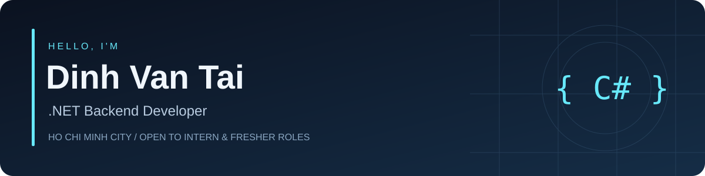

  

  <b>ASP.NET Core · React · SQL</b> 
  Building web applications with a focus on business workflows and data access control.

  Contact: dinhvantai079@gmail.com

### 👋 About me

I'm **Đinh Văn Tài**, an Information Technology graduate based in Ho Chi Minh City, Vietnam.

- Seeking a **.NET Backend Internship / Fresher Developer** opportunity.
- Working with **C#, ASP.NET Core, Entity Framework Core and REST APIs**.
- Building React interfaces and exploring reliable autosave, offline synchronization and role-based access.
- Currently improving three projects: **NoteTatCa**, **M-ChamCong** and **BadmintonBooking**.

### 🧰 Technologies used in my projects

| Area | Technologies |
| :--- | :--- |
| Backend | C#, ASP.NET Core 8, Entity Framework Core, ASP.NET Identity, JWT |
| Frontend | React, TypeScript, JavaScript, Vite, HTML, CSS |
| Databases | SQL Server, PostgreSQL, MySQL |
| Development & testing | Git, GitHub, Postman, Swagger/OpenAPI, Playwright, Vitest |
| Deployment tooling | Docker, Render, Vercel |

### 🚀 Featured projects

#### [NoteTatCa](https://github.com/taiDinh303/NoteTatCa) · Private notes workspace

**ASP.NET Core 8 · React · TypeScript · EF Core**

A personal note application with a rich-text editor, labels, reminders and a trash workflow.

- Per-user note ownership checks and separate administration workflows.
- Autosave with version conflict handling and retry states that preserve drafts.
- Local offline note storage and synchronization workflows using IndexedDB.

**Status:** actively developed; browser and backend test evidence is recorded in the repository documentation. Offline functionality has browser and storage limitations.

#### [M-ChamCong](https://github.com/taiDinh303/M-ChamCong) · Attendance & HR workflows

**ASP.NET Core 8 · React · EF Core · SQL Server / PostgreSQL**

A web application for attendance check-in/out, attendance corrections, leave requests and employee administration.

- Identity/JWT authentication with Admin, Manager, HR and Employee permissions.
- Attendance logs and working-time calculations based on attendance rules.
- React modules for employees and management workflows.

**Status:** in development. Offline attendance, period locking and attendance exports remain planned work.

#### [BadmintonBooking](https://github.com/taiDinh303/Badminton) · Court booking platform

**ASP.NET Core 8 · React · TypeScript · EF Core**

A court booking project currently being rebuilt and refined.

- Booking and branch-scoped management workflows.
- Public landing page and customer contact form with an admin inbox.
- Automated frontend and focused HTTP test coverage documented in the repository.

**Status:** work in progress. Payment-provider certification and complete production validation remain ongoing.

---

Interested in backend development, practical business problems and learning through building.

